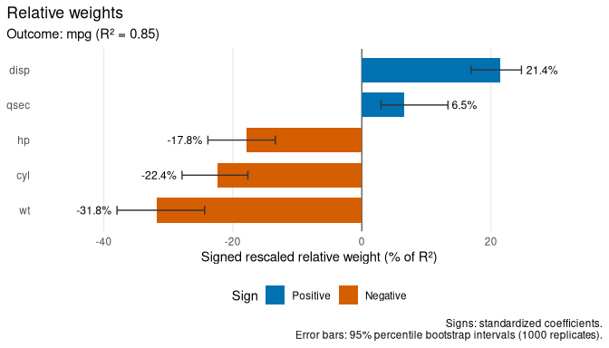
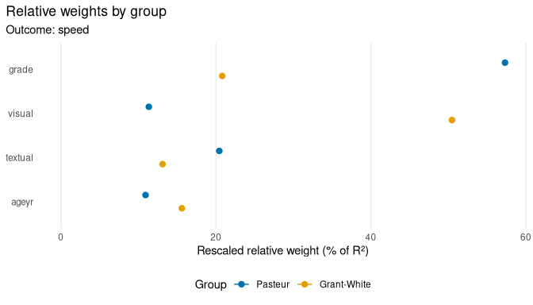

<!-- README.md is generated from README.Rmd. Please edit that file. -->

# relweights

<!-- badges: start -->

[](https://github.com/michaelides/relweights/actions/workflows/R-CMD-check.yaml)
<!-- badges: end -->

relweights computes Johnson’s (2000) relative weights. They divide the
explained variance ($R^2$) of a regression among correlated predictors.
Each predictor is credited with its unique contribution and with its
share of what it explains together with the other predictors. The
weights are non-negative and sum to $R^2$.

The analysis works directly on fitted models:

- **linear models** fitted with `lm()`, including models with prior
  weights;
- **structural equation models** fitted with
  [lavaan](https://lavaan.ugent.be). Every structural regression is
  analysed, including regressions among latent variables, using the
  model-implied correlations, separately for each group and level.

Each analysis returns:

- raw weights and rescaled weights (percentages of $R^2$);
- standardized coefficients and zero-order correlations;
- the signs of the standardized coefficients and of the coefficients of
  the orthogonal counterparts;
- optional bootstrap percentile intervals;
- ggplot2 plots.

## Installation

relweights is not yet on CRAN. Install the development version from
[GitHub](https://github.com/michaelides/relweights):

``` r
# install.packages("remotes")
remotes::install_github("michaelides/relweights", build_vignettes = TRUE)
```

## Linear models

``` r
library(relweights)

fit <- lm(mpg ~ cyl + disp + hp + wt + qsec, data = mtcars)
set.seed(2024)
rw <- relweights(fit, bootstrap = TRUE, n_boot = 1000)
rw
#> Relative weight analysis (Johnson, 2000)
#> Model: lm(formula = mpg ~ cyl + disp + hp + wt + qsec, data = mtcars)
#> 
#> Outcome: mpg
#> R-squared = 0.850 [0.794, 0.935], n = 32
#> 
#>  predictor   raw         raw CI rescaled  rescaled CI   beta      r sign
#>        cyl 0.191 [0.148, 0.244]     22.4 [17.7, 27.9] -0.343 -0.852  -/-
#>       disp 0.182 [0.141, 0.221]     21.4 [16.9, 24.7]  0.246 -0.848  +/-
#>         hp 0.151 [0.118, 0.208]     17.8 [13.4, 23.9] -0.180 -0.776  -/-
#>         wt 0.271 [0.205, 0.334]     31.8 [24.4, 37.9] -0.686 -0.868  -/-
#>       qsec 0.055 [0.027, 0.116]      6.5  [3.0, 13.4]  0.075  0.419  +/+
#> 
#> raw: raw weights (sum to R-squared); rescaled: % of R-squared;
#> beta: standardized coefficients; r: zero-order correlations;
#> sign: signs of beta / orthogonal-counterpart coefficients.
#> The two signs differ for: disp (mpg).
#> Intervals: 95% percentile bootstrap intervals from 1000 replicates.
```

``` r
autoplot(rw, sign = "beta")
```



## Structural equation models

``` r
model <- "
  visual  =~ x1 + x2 + x3
  textual =~ x4 + x5 + x6
  speed   =~ x7 + x8 + x9
  speed ~ visual + textual + ageyr + grade
"
sem_fit <- lavaan::sem(model, data = lavaan::HolzingerSwineford1939,
                       group = "school")
rw_sem <- relweights(sem_fit)
rw_sem
#> Relative weight analysis (Johnson, 2000)
#> Model: lavaan model; groups: Pasteur, Grant-White
#> 
#> Outcome: speed [Pasteur]
#> R-squared = 0.219, n = 156
#> 
#>  predictor   raw rescaled  beta     r sign
#>     visual 0.025     11.3 0.108 0.201  +/+
#>    textual 0.045     20.4 0.194 0.246  +/+
#>      ageyr 0.024     10.9 0.059 0.212  +/+
#>      grade 0.125     57.3 0.357 0.383  +/+
#> 
#> Outcome: speed [Grant-White]
#> R-squared = 0.364, n = 144
#> 
#>  predictor   raw rescaled  beta     r sign
#>     visual 0.184     50.5 0.443 0.478  +/+
#>    textual 0.048     13.1 0.066 0.304  +/+
#>      ageyr 0.057     15.6 0.163 0.312  +/+
#>      grade 0.076     20.8 0.240 0.341  +/+
#> 
#> raw: raw weights (sum to R-squared); rescaled: % of R-squared;
#> beta: standardized coefficients; r: zero-order correlations;
#> sign: signs of beta / orthogonal-counterpart coefficients.
```

``` r
autoplot(rw_sem, type = "groups")
```



Other plots show how $R^2$ divides among the predictors
(`autoplot(rw, type = "r2")`) and set relative weights next to squared
standardized coefficients and squared correlations
(`autoplot(rw, type = "compare")`).

## Learn more

`vignette("relweights")` covers the method, signs, factors, bootstrap
intervals and the analysis of lavaan models in detail. The test suite
checks the results against the
[rwa](https://CRAN.R-project.org/package=rwa) package, which implements
relative weights for data frames.

## Citation

If you use relweights in published work, please cite the package:

Michaelides G (2026). *relweights: Relative Weight Analysis for Linear
Models and Structural Equation Models*. R package version 0.1.0,
<https://github.com/michaelides/relweights>.

A BibTeX entry for LaTeX users:

``` bibtex
@Manual{relweights,
  title = {{relweights}: Relative Weight Analysis for Linear Models and Structural Equation Models},
  author = {George Michaelides},
  year = {2026},
  note = {R package version 0.1.0},
  url = {https://github.com/michaelides/relweights},
}
```

Please also cite Johnson (2000) for the relative weights method and,
when you analyse lavaan models, Rosseel (2012); see the references
below. In R, `citation("relweights")` shows this information.

## References

Johnson, J. W. (2000). A heuristic method for estimating the relative
weight of predictor variables in multiple regression. *Multivariate
Behavioral Research, 35*(1), 1–19.
<https://doi.org/10.1207/S15327906MBR3501_1>

Rosseel, Y. (2012). lavaan: An R package for structural equation
modeling. *Journal of Statistical Software, 48*(2), 1–36.
<https://doi.org/10.18637/jss.v048.i02>

Tonidandel, S., & LeBreton, J. M. (2011). Relative importance analysis:
A useful supplement to regression analysis. *Journal of Business and
Psychology, 26*(1), 1–9. <https://doi.org/10.1007/s10869-010-9204-3>
