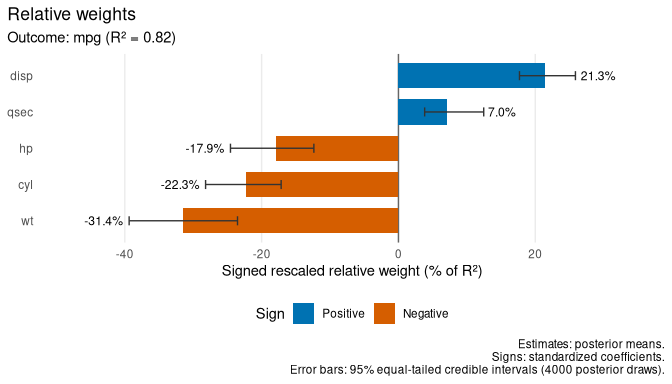
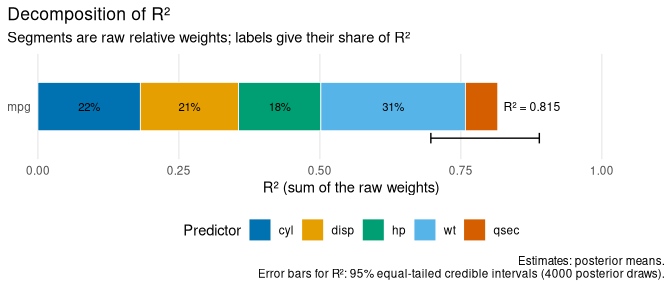
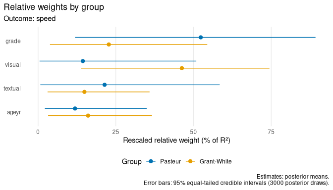

<!-- bayesian.Rmd is generated from bayesian.Rmd.orig: edit the .orig file
and knit it with knitr::knit("bayesian.Rmd.orig", "bayesian.Rmd") in the
vignettes folder. -->


A Bayesian model describes what is known about its parameters with draws
from their posterior distribution. relweights repeats the relative weight
analysis in every draw: each draw implies its own correlations, weights and
$R^2$, and together the per-draw results form the posterior distribution of
the weights. From it, relweights reports

* posterior means of the raw and rescaled weights, standardized
  coefficients, correlations and $R^2$. Means are used rather than medians
  because they add up: the raw weights sum to the mean $R^2$ and the
  rescaled weights to 100;
* equal-tailed credible intervals;
* the posterior probabilities that each standardized coefficient and each
  orthogonal-counterpart coefficient is positive;
* the probabilities that each predictor has a given rank, and that one
  weight exceeds another.

The examples use linear models fitted with brms and structural equation
models fitted with blavaan. Both run Stan, so the code and output shown here
were produced in advance.


``` r
library(relweights)
```

## Linear models with brms

This is the regression of fuel economy on five correlated car
characteristics from the introductory vignette, fitted with brms and its
default priors:


``` r
library(brms)
fit_b <- brm(mpg ~ cyl + disp + hp + wt + qsec, data = mtcars,
             seed = 2024, refresh = 0)
```


``` r
rw_b <- relweights(fit_b)
rw_b
#> Relative weight analysis (Johnson, 2000)
#> Model: brms model (gaussian, identity link): mpg ~ cyl + disp + hp + wt + qsec
#> 
#> Outcome: mpg
#> R-squared = 0.815 [0.697, 0.889] (bayes_R2: 0.827), n = 32
#> 
#>  predictor   raw        raw CrI rescaled rescaled CrI   beta      r sign
#>        cyl 0.182 [0.132, 0.232]     22.3 [17.1, 28.2] -0.328 -0.822  -/-
#>       disp 0.174 [0.134, 0.213]     21.3 [17.7, 25.9]  0.239 -0.817  +/-
#>         hp 0.146 [0.095, 0.201]     17.9 [12.4, 24.6] -0.173 -0.749  -/-
#>         wt 0.256 [0.182, 0.326]     31.4 [23.5, 39.4] -0.666 -0.837  -/-
#>       qsec 0.057 [0.030, 0.101]      7.0  [3.8, 12.5]  0.076  0.405  +/+
#> 
#>  predictor P(beta > 0) P(orth > 0) P(rank 1)
#>        cyl       0.058       0.000     0.059
#>       disp       0.838       0.000     0.007
#>         hp       0.154       0.000     0.016
#>         wt       0.001       0.000     0.917
#>       qsec       0.706       0.979     0.000
#> 
#> raw: raw weights (sum to R-squared); rescaled: % of R-squared;
#> beta: standardized coefficients; r: zero-order correlations;
#> sign: signs of beta / orthogonal-counterpart coefficients.
#> The two signs differ for: disp (mpg).
#> Estimates are posterior means. Intervals: 95% equal-tailed credible intervals
#> from 4000 posterior draws (4 chains).
#> Raw weights: largest R-hat = 1.001, smallest bulk ESS = 2814.
```

The first table has the same columns as for a linear model, with posterior
means as estimates and credible intervals (`CrI`). The second gives, for
each predictor, the posterior probabilities that its standardized
coefficient (`beta`) and its orthogonal-counterpart coefficient (`orth`) are
positive, and that it has the largest weight. Weight (`wt`) is very likely
the most important predictor. The engine measures share most of the rest,
and the data cannot tell well which of them matters most. The two sign
probabilities of `disp` show the suppression pattern discussed in the
introductory vignette: its coefficient is probably positive, although its
orthogonal counterpart is certainly negatively related to `mpg`.

With brms's default flat priors on the coefficients, the weights are close
to those of the least-squares fit:


``` r
rw_lm <- relweights(lm(mpg ~ cyl + disp + hp + wt + qsec, data = mtcars))
data.frame(
  predictor = rw_b$weights$predictor,
  lm = round(rw_lm$weights$rescaled, 1),
  brms = round(rw_b$weights$rescaled, 1)
)
#>   predictor   lm brms
#> 1       cyl 22.4 22.3
#> 2      disp 21.4 21.3
#> 3        hp 17.8 17.9
#> 4        wt 31.8 31.4
#> 5      qsec  6.5  7.0
```

The posterior mean of a weight is not the weight at the posterior mean of
the coefficients. Weights cannot be negative, so the uncertainty about a
small weight raises its posterior mean, as for `qsec` here.

### R-squared

In each draw, the coefficients $b$, the residual standard deviation $\sigma$
and the covariance matrix $S$ of the predictors imply the outcome variance
$b'Sb + \sigma^2$. The raw weights sum to the model-based
$R^2 = b'Sb / (b'Sb + \sigma^2)$ of Gelman et al. (2019). Column `r2_model`
holds the posterior mean of the residual-based $R^2$ that
`brms::bayes_R2()` reports, which uses the variance of the residuals instead
of $\sigma^2$; the two are usually close:


``` r
rw_b$r2
#>   block group level outcome  n        r2  r2_model  r2_lower  r2_upper
#> 1     1  <NA>  <NA>     mpg 32 0.8154519 0.8265987 0.6968749 0.8892444
```

### Plots

The plots of the introductory vignette work in the same way. Bars show
posterior means and error bars credible intervals:


``` r
autoplot(rw_b, sign = "beta")
```

<div class="figure">

<p class="caption">plot of chunk brms-weights</p>
</div>


``` r
autoplot(rw_b, type = "r2")
```

<div class="figure">

<p class="caption">plot of chunk brms-r2</p>
</div>

### Ranks and comparisons

`as.data.frame()` returns the rank probabilities and the probabilities that
one weight exceeds another:


``` r
ranks <- as.data.frame(rw_b, what = "ranks")
subset(ranks, rank == 1, c(predictor, probability))
#>    predictor probability
#> 1        cyl     0.05950
#> 6       disp     0.00725
#> 11        hp     0.01600
#> 16        wt     0.91725
#> 21      qsec     0.00000

pairs <- as.data.frame(rw_b, what = "pairwise")
subset(pairs, predictor == "wt", c(predictor, other, probability))
#>    predictor other probability
#> 13        wt   cyl     0.93475
#> 14        wt  disp     0.98500
#> 15        wt    hp     0.97950
#> 16        wt  qsec     0.99975
```

The draws themselves are kept in `rw_b$draws`, so other summaries are easy
to compute. For example, the 90% credible interval of the share of $R^2$
that belongs to weight:


``` r
share_wt <- rw_b$draws$regressions$mpg$rescaled[, "wt"]
quantile(share_wt, c(0.05, 0.95))
#>       5%      95% 
#> 24.60439 38.09260
```

### What the intervals include

brms treats the predictors as fixed, so their correlations are the same in
every draw, and the credible intervals reflect the uncertainty of the
coefficients and of $\sigma$ only. The bootstrap of a linear model also
resamples the predictors, so the two kinds of interval describe different
sources of uncertainty. In this small sample their widths are similar:


``` r
set.seed(2024)
rw_boot <- relweights(lm(mpg ~ cyl + disp + hp + wt + qsec, data = mtcars),
                      bootstrap = TRUE, n_boot = 1000)
data.frame(
  predictor = rw_b$weights$predictor,
  bootstrap = round(rw_boot$weights$rescaled_upper -
                      rw_boot$weights$rescaled_lower, 1),
  credible = round(rw_b$weights$rescaled_upper -
                     rw_b$weights$rescaled_lower, 1)
)
#>   predictor bootstrap credible
#> 1       cyl      10.2     11.0
#> 2      disp       7.8      8.2
#> 3        hp      10.5     12.2
#> 4        wt      13.6     15.8
#> 5      qsec      10.4      8.6
```

### Supported models

relweights supports brms models with the gaussian family, the identity link
and population-level effects. Multivariate models are analysed one response
at a time, and `outcome` selects responses:


``` r
fit_mv <- brm(bf(mvbind(mpg, qsec) ~ cyl + disp + hp + wt) +
                set_rescor(TRUE), data = mtcars)
relweights(fit_mv, outcome = "qsec")
```

Group-level terms, predicted distributional parameters (such as
`sigma ~ x`), non-linear formulas, smooth, special, Gaussian process and
autocorrelation terms, offsets and addition terms (`y | ...`) are refused
with an explanation. As for linear models, a factor with more than two
levels receives one weight per dummy variable, with a warning that these
weights depend on the coding.

## Structural equation models with blavaan

For a blavaan model, relweights puts the parameters of each draw into the
model and recomputes the model-implied correlations among all observed and
latent variables, in every group and level. Every regression is then
analysed as for lavaan models. Because the correlations among latent
variables differ from draw to draw, the credible intervals reflect the
uncertainty of the whole model.


``` r
library(blavaan)
hs_model <- "
  visual  =~ x1 + x2 + x3
  textual =~ x4 + x5 + x6
  speed   =~ x7 + x8 + x9
  speed ~ visual + textual + ageyr + grade
"
hs_data <- lavaan::HolzingerSwineford1939
fit_bsem <- bsem(hs_model, data = hs_data, seed = 2025)
```


``` r
rw_bsem <- relweights(fit_bsem)
rw_bsem
#> Relative weight analysis (Johnson, 2000)
#> Model: blavaan model
#> 
#> Outcome: speed
#> R-squared = 0.304 [0.185, 0.437], n = 300
#> 
#>  predictor   raw        raw CrI rescaled rescaled CrI  beta     r sign
#>     visual 0.123 [0.033, 0.252]     39.4 [13.8, 65.7] 0.336 0.376  +/+
#>    textual 0.038 [0.006, 0.096]     12.6  [2.4, 29.7] 0.092 0.244  +/+
#>      ageyr 0.052 [0.014, 0.106]     17.1  [5.0, 33.6] 0.144 0.283  +/+
#>      grade 0.091 [0.030, 0.171]     30.8  [9.8, 57.9] 0.271 0.345  +/+
#> 
#>  predictor P(beta > 0) P(orth > 0) P(rank 1)
#>     visual       1.000       1.000     0.614
#>    textual       0.864       0.992     0.016
#>      ageyr       0.971       0.999     0.033
#>      grade       1.000       1.000     0.337
#> 
#> raw: raw weights (sum to R-squared); rescaled: % of R-squared;
#> beta: standardized coefficients; r: zero-order correlations;
#> sign: signs of beta / orthogonal-counterpart coefficients.
#> Estimates are posterior means. Intervals: 95% equal-tailed credible intervals
#> from 3000 posterior draws (3 chains).
#> Raw weights: largest R-hat = 1.002, smallest bulk ESS = 2758.
```

The weights are close to those of the maximum likelihood fit:


``` r
rw_ml <- relweights(lavaan::sem(hs_model, data = hs_data))
data.frame(
  predictor = rw_bsem$weights$predictor,
  lavaan = round(rw_ml$weights$rescaled, 1),
  blavaan = round(rw_bsem$weights$rescaled, 1)
)
#>   predictor lavaan blavaan
#> 1    visual   40.9    39.4
#> 2   textual   11.7    12.6
#> 3     ageyr   17.2    17.1
#> 4     grade   30.1    30.8
```

### Groups

Models with several groups are analysed group by group, and the `"groups"`
plot sets them side by side:


``` r
fit_groups <- bsem(hs_model, data = hs_data, group = "school", seed = 2025)
```


``` r
rw_groups <- relweights(fit_groups)
autoplot(rw_groups, type = "groups")
```

<div class="figure">

<p class="caption">plot of chunk blavaan-groups</p>
</div>

Both groups come from the same posterior draws, so the draws also answer
questions that compare groups. For example, the posterior probability that
`visual` has a larger share of $R^2$ in the Grant-White school than in the
Pasteur school:


``` r
draws <- rw_groups$draws$regressions
mean(draws[["speed [Grant-White]"]]$rescaled[, "visual"] >
       draws[["speed [Pasteur]"]]$rescaled[, "visual"])
#> [1] 0.9216667
```

Two-level models are analysed at each level in the same way; unlike the
bootstrap, this needs no refitting.

Exogenous observed covariates (here `ageyr` and `grade`) are treated as
fixed by default (`fixed.x = TRUE`), so the uncertainty of their covariances
is not part of the intervals.

## Convergence and number of draws

Columns `rhat` and `ess_bulk` of the weights table give the R-hat and the
bulk effective sample size of each raw weight, computed with the posterior
package. `print()` reports the largest R-hat and the smallest ESS, and
relweights warns when an R-hat exceeds 1.05.


``` r
rw_bsem$weights[, c("predictor", "raw", "rhat", "ess_bulk")]
#>   predictor        raw      rhat ess_bulk
#> 1    visual 0.12260332 1.0003206 2758.339
#> 2   textual 0.03840967 1.0020696 3737.510
#> 3     ageyr 0.05163166 1.0008979 3425.699
#> 4     grade 0.09090629 0.9997698 3451.668
```

The diagnostics matter for latent-variable models. With some random
seeds, one chain of the model above gets stuck where the variance of
`visual` is almost zero and its loadings are huge. The weights of that
chain then differ from those of the others, and relweights warns about
their R-hat, as blavaan's own diagnostics
(`blavInspect(fit_bsem, "psrf")`) warn about the parameters. Such a model
needs longer or more chains, or different starting values, before its
weights can be interpreted.

For large models, `ndraws` analyses a subset of evenly spaced draws from
every chain, for example `relweights(fit_bsem, ndraws = 1000)`.

## Caveats

* Weights cannot be negative, so their credible intervals never include
  zero, and an interval above zero is not evidence that a predictor
  matters. Tonidandel et al. (2009) compare each weight with the weight of
  a random predictor instead.
* The weights depend on the priors, like every other result of a Bayesian
  model. Informative priors on the coefficients shift the weights.
* The relative weight method is a heuristic (see the introductory
  vignette). The Bayesian analysis describes the uncertainty of the weights;
  it does not change what they mean.

## References

Bürkner, P.-C. (2017). brms: An R package for Bayesian multilevel models
using Stan. *Journal of Statistical Software, 80*(1), 1--28.
https://doi.org/10.18637/jss.v080.i01

Gelman, A., Goodrich, B., Gabry, J., & Vehtari, A. (2019). R-squared for
Bayesian regression models. *The American Statistician, 73*(3), 307--309.
https://doi.org/10.1080/00031305.2018.1549100

Johnson, J. W. (2000). A heuristic method for estimating the relative weight
of predictor variables in multiple regression. *Multivariate Behavioral
Research, 35*(1), 1--19. https://doi.org/10.1207/S15327906MBR3501_1

Merkle, E. C., Fitzsimmons, E., Uanhoro, J., & Goodrich, B. (2021).
Efficient Bayesian structural equation modeling in Stan. *Journal of
Statistical Software, 100*(6), 1--22. https://doi.org/10.18637/jss.v100.i06

Tonidandel, S., LeBreton, J. M., & Johnson, J. W. (2009). Determining the
statistical significance of relative weights. *Psychological Methods,
14*(4), 387--399. https://doi.org/10.1037/a0017735
